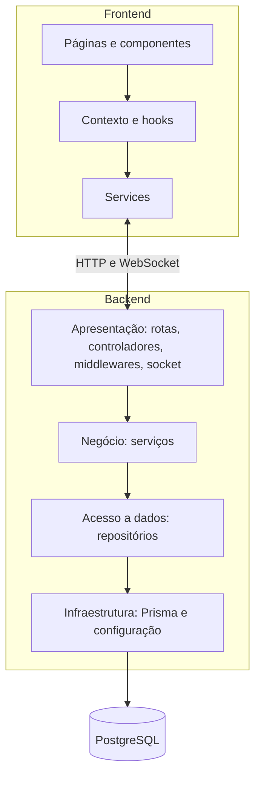
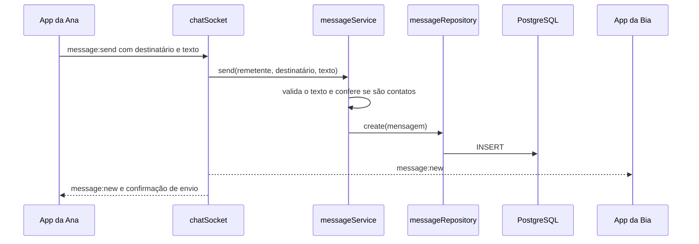
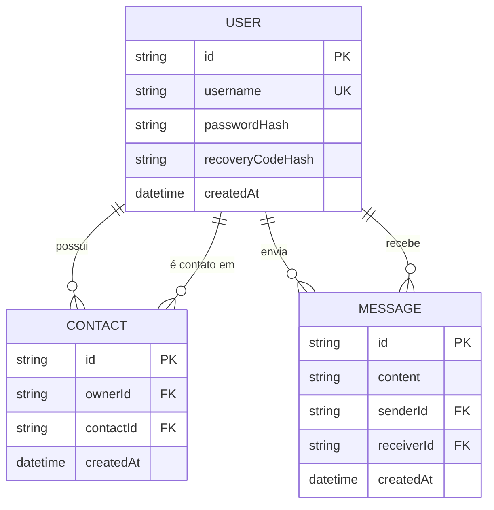

# SH Messenger

Messenger web em tempo real que funciona **sem número de telefone e sem e-mail**. Basta um nome de usuário e uma senha para conversar com os amigos, de qualquer aparelho, com o app instalável na tela inicial do celular.


**[Acesse o app](https://sh-messenger.vercel.app)** · uso restrito por código de convite

## Sumário

- [Sobre o projeto](#sobre-o-projeto)
- [Funcionalidades](#funcionalidades)
- [Tecnologias](#tecnologias)
- [Arquitetura](#arquitetura)
- [Estrutura de pastas](#estrutura-de-pastas)
- [Modelo de dados](#modelo-de-dados)
- [API](#api)
- [Segurança e privacidade](#segurança-e-privacidade)
- [Como rodar localmente](#como-rodar-localmente)
- [Variáveis de ambiente](#variáveis-de-ambiente)
- [Scripts disponíveis](#scripts-disponíveis)
- [Deploy](#deploy)
- [Roadmap](#roadmap)
- [Licença](#licença)
- [Autoria](#autoria)

---

## Sobre o projeto

A maioria dos messengers exige um número de telefone ou um e-mail para criar conta, o que liga a identidade do usuário a dados pessoais sensíveis. O **SH Messenger** foi criado para mostrar que dá para ter uma experiência completa de chat sem coletar nenhum desses dados.

O projeto tem dois objetivos:

1. **Uso real:** servir como canal de conversa privado entre um grupo de amigos, hospedado inteiramente em planos gratuitos.
2. **Estudo:** aplicar na prática a **arquitetura em camadas**, tanto no backend quanto no frontend, com separação clara de responsabilidades.

Como não existe e-mail para o fluxo de "esqueci minha senha", a recuperação de conta é feita por um **código secreto** gerado no cadastro, no mesmo modelo dos códigos de backup usados em autenticação de dois fatores.

## Funcionalidades

- **Cadastro anônimo:** apenas nome de usuário e senha, sem telefone ou e-mail.
- **Recuperação de conta por código:** um código de 16 caracteres é exibido uma única vez no cadastro e renovado a cada uso.
- **Cadastro por convite:** quando configurado, só quem tem o código de convite consegue criar conta.
- **Contatos:** adição de amigos pelo nome de usuário, com amizade mútua automática.
- **Mensagens em tempo real:** entrega instantânea via WebSocket, sincronizada entre todos os aparelhos abertos de cada usuário.
- **Histórico paginado:** carregamento das conversas em blocos de 50 mensagens.
- **PWA:** instalável no Android, no iPhone e no computador, abrindo em tela cheia como um aplicativo nativo.
- **Tema claro e escuro:** acompanha automaticamente a preferência do sistema.
- **Layout responsivo:** no celular, lista de contatos e conversa ocupam a tela inteira, uma de cada vez.

## Tecnologias

| Camada | Tecnologia | Finalidade |
| --- | --- | --- |
| Backend | [Node.js](https://nodejs.org) + [Express 5](https://expressjs.com) | Servidor HTTP e API REST |
| Tempo real | [Socket.IO](https://socket.io) | Entrega de mensagens via WebSocket |
| Banco de dados | [PostgreSQL](https://www.postgresql.org) + [Prisma 6](https://www.prisma.io) | Persistência, migrations e acesso tipado aos dados |
| Validação | [Zod](https://zod.dev) | Validação e normalização das entradas |
| Autenticação | [jsonwebtoken](https://github.com/auth0/node-jsonwebtoken) + [bcryptjs](https://github.com/dcodeIO/bcrypt.js) | Sessões por token e hash de senhas |
| Proteção | [express-rate-limit](https://github.com/express-rate-limit/express-rate-limit) | Limite de tentativas nas rotas de autenticação |
| Frontend | [React](https://react.dev) + [Vite](https://vite.dev) | Interface e build |
| PWA | [vite-plugin-pwa](https://vite-pwa-org.netlify.app) | Manifesto e service worker |
| Hospedagem | [Render](https://render.com), [Vercel](https://vercel.com), [Neon](https://neon.tech) | Backend, frontend e banco, em planos gratuitos |

## Arquitetura

O projeto segue o padrão de **arquitetura em camadas**: cada camada só conversa com a camada imediatamente abaixo dela. Isso mantém as regras de negócio independentes do framework web e do banco de dados.



### Backend

| Camada | Pastas | Responsabilidade |
| --- | --- | --- |
| Apresentação | `routes/`, `controllers/`, `middlewares/`, `validators/`, `sockets/` | Recebe requisições HTTP e eventos WebSocket, valida a entrada, autentica e devolve respostas |
| Negócio | `services/`, `errors/` | Regras da aplicação: cadastro, login, recuperação de conta, contatos e permissões de envio |
| Acesso a dados | `repositories/` | Consultas e gravações no banco por meio do Prisma |
| Infraestrutura | `config/`, `prisma/` | Variáveis de ambiente, conexão com o banco e esquema das tabelas |

Os serviços não conhecem `req`/`res` nem SQL. Por isso a mesma regra de negócio é reutilizada tanto pelas rotas HTTP quanto pelo Socket.IO, e pode ser testada isoladamente, sem servidor nem banco.

### Frontend

| Camada | Pastas | Responsabilidade |
| --- | --- | --- |
| Interface | `pages/`, `components/` | O que aparece na tela; recebe dados e funções por props |
| Estado | `contexts/`, `hooks/` | Sessão do usuário, lista de contatos e mensagens organizadas por conversa |
| Services | `services/` | Comunicação com a API REST e com o socket |

### Fluxo de uma mensagem



## Estrutura de pastas

```text
meu-messenger/
├── backend/
│   ├── prisma/
│   │   ├── migrations/          # Histórico de alterações do banco
│   │   └── schema.prisma        # Definição das tabelas
│   ├── src/
│   │   ├── config/              # Variáveis de ambiente e cliente Prisma
│   │   ├── controllers/         # Tradução entre HTTP e serviços
│   │   ├── errors/              # Erros de negócio (AppError)
│   │   ├── middlewares/         # Autenticação, validação e tratamento de erros
│   │   ├── repositories/        # Acesso ao banco
│   │   ├── routes/              # Definição dos endpoints
│   │   ├── services/            # Regras de negócio
│   │   ├── sockets/             # Eventos em tempo real
│   │   ├── validators/          # Esquemas Zod
│   │   ├── app.js               # Montagem do Express
│   │   └── server.js            # Inicialização do HTTP e do Socket.IO
│   └── .env.example
└── frontend/
    ├── public/                  # Ícones do PWA
    ├── src/
    │   ├── components/          # Componentes reutilizáveis
    │   ├── contexts/            # Contexto de autenticação
    │   ├── hooks/               # Estado das conversas
    │   ├── pages/               # Telas de login e de chat
    │   ├── services/            # Cliente HTTP e socket
    │   ├── styles/              # Estilos globais e temas
    │   ├── App.jsx
    │   └── main.jsx
    ├── vite.config.js           # Configuração do Vite e do PWA
    └── .env.example
```

## Modelo de dados

O banco tem três tabelas. Nenhuma delas armazena telefone, e-mail ou senhas em texto puro.



- **User:** identificador, nome de usuário único e os hashes da senha e do código de recuperação.
- **Contact:** relação de amizade; cada amizade é gravada nos dois sentidos, com restrição de unicidade por par.
- **Message:** mensagens diretas entre dois usuários, com índice por remetente, destinatário e data para acelerar o histórico.

Ao excluir um usuário, seus contatos e mensagens são removidos em cascata.

## API

Todas as rotas da API usam o prefixo `/api`. As rotas protegidas exigem o cabeçalho `Authorization: Bearer <token>`.

### Endpoints REST

| Método | Rota | Protegida | Descrição |
| --- | --- | :---: | --- |
| `POST` | `/api/auth/register` | Não | Cria uma conta. Corpo: `username`, `password` e `inviteCode` (quando exigido). Retorna `user`, `token` e `recoveryCode`. |
| `POST` | `/api/auth/login` | Não | Autentica. Corpo: `username` e `password`. Retorna `user` e `token`. |
| `POST` | `/api/auth/recover` | Não | Redefine a senha. Corpo: `username`, `recoveryCode` e `newPassword`. Retorna um novo `recoveryCode`. |
| `GET` | `/api/auth/me` | Sim | Retorna o usuário autenticado. |
| `GET` | `/api/contacts` | Sim | Lista os contatos do usuário. |
| `POST` | `/api/contacts` | Sim | Adiciona um contato pelo nome de usuário. Corpo: `username`. |
| `GET` | `/api/messages/:contactId` | Sim | Histórico da conversa, até 50 mensagens. Parâmetro opcional `?before=<data ISO>` para paginação. |
| `GET` | `/health` | Não | Verificação de saúde do servidor. |

Erros seguem o formato `{ "error": "mensagem" }`, com os códigos HTTP `400` (entrada inválida), `401` (não autenticado), `403` (sem permissão), `404` (não encontrado), `409` (conflito) e `500` (erro interno).

### Eventos WebSocket

A conexão exige o token no handshake: `io(URL, { auth: { token } })`.

| Direção | Evento | Dados | Descrição |
| --- | --- | --- | --- |
| Cliente -> Servidor | `message:send` | `{ to, content }` | Envia uma mensagem. A confirmação retorna `{ ok: true }` ou `{ ok: false, error }`. |
| Servidor -> Cliente | `message:new` | Objeto da mensagem | Entregue ao destinatário e a todos os aparelhos abertos do remetente. |

## Segurança e privacidade

- **Coleta mínima de dados:** nenhuma informação pessoal é solicitada ou armazenada.
- **Senhas e códigos com hash:** senhas e códigos de recuperação são guardados com bcrypt (custo 12); nem o administrador do banco consegue lê-los.
- **Mensagens de erro genéricas no login:** a resposta é a mesma para usuário inexistente e senha incorreta, impedindo a descoberta de nomes cadastrados.
- **Limite de tentativas:** as rotas de autenticação aceitam um número limitado de requisições por IP a cada 15 minutos.
- **Convite com comparação em tempo constante:** o código de convite é verificado com `crypto.timingSafeEqual`, evitando ataques de temporização.
- **Validação de entrada:** todas as requisições passam por esquemas Zod antes de chegar às regras de negócio.
- **Sessões com expiração:** tokens JWT expiram em 7 dias.
- **CORS restrito:** a API só aceita requisições vindas do endereço oficial do frontend.
- **Proteção contra XSS:** o conteúdo das mensagens é sempre renderizado como texto pelo React.
- **Segredos fora do repositório:** credenciais ficam em variáveis de ambiente; os arquivos `.env` são ignorados pelo Git.

**Limitação conhecida:** as mensagens trafegam protegidas por HTTPS, mas ficam legíveis no banco de dados. A criptografia de ponta a ponta está no [roadmap](#roadmap).

## Como rodar localmente

### Pré-requisitos

- [Node.js](https://nodejs.org) na versão LTS
- [Git](https://git-scm.com)
- Um banco PostgreSQL; o plano gratuito do [Neon](https://neon.tech) é suficiente

### 1. Clonar o repositório

```bash
git clone https://github.com/SharaIsabell/meu-messenger.git
cd meu-messenger
```

### 2. Configurar e iniciar o backend

```bash
cd backend
cp .env.example .env      # depois preencha os valores no arquivo .env
npm install               # também gera o cliente Prisma
npx prisma migrate dev    # cria as tabelas no banco
npm run dev               # inicia em http://localhost:3000
```

Para gerar um valor seguro para `JWT_SECRET`:

```bash
node -e "console.log(require('crypto').randomBytes(48).toString('hex'))"
```

### 3. Configurar e iniciar o frontend

Em outro terminal, a partir da raiz do projeto:

```bash
cd frontend
cp .env.example .env
npm install
npm run dev               # inicia em http://localhost:5173
```

Abra `http://localhost:5173`. Para testar a conversa em tempo real, crie duas contas, uma em uma janela normal e outra em uma janela anônima do navegador.

## Variáveis de ambiente

### Backend (`backend/.env`)

| Variável | Obrigatória | Descrição |
| --- | :---: | --- |
| `DATABASE_URL` | Sim | Connection string do PostgreSQL (conexão direta, não a pooled). |
| `JWT_SECRET` | Sim | Chave secreta longa e aleatória usada para assinar os tokens. |
| `CLIENT_URL` | Sim | Endereço do frontend permitido pelo CORS, sem barra no final. |
| `PORT` | Não | Porta do servidor. Padrão `3000`; em produção, definida pela hospedagem. |
| `INVITE_CODE` | Não | Se preenchida, o cadastro passa a exigir este código. |

### Frontend (`frontend/.env`)

| Variável | Obrigatória | Descrição |
| --- | :---: | --- |
| `VITE_API_URL` | Sim | Endereço do backend, sem barra no final. |

## Scripts disponíveis

### Backend

| Comando | Descrição |
| --- | --- |
| `npm run dev` | Inicia o servidor e reinicia automaticamente a cada alteração. |
| `npm start` | Inicia o servidor em modo de produção. |
| `npx prisma migrate dev` | Cria e aplica migrations no ambiente de desenvolvimento. |
| `npx prisma studio` | Abre uma interface no navegador para visualizar o banco. |

### Frontend

| Comando | Descrição |
| --- | --- |
| `npm run dev` | Inicia o servidor de desenvolvimento do Vite. |
| `npm run build` | Gera a versão de produção na pasta `dist`. |
| `npm run preview` | Serve localmente a versão de produção, com o PWA ativo. |
| `npm run lint` | Analisa o código com ESLint. |

## Deploy

A aplicação roda inteiramente em planos gratuitos:

| Serviço | Parte | Configuração principal |
| --- | --- | --- |
| **Neon** | Banco de dados | Projeto PostgreSQL na região de São Paulo. |
| **Render** | Backend | Web Service com diretório raiz `backend`, build `npm install && npx prisma migrate deploy` e start `npm start`. |
| **Vercel** | Frontend | Projeto com diretório raiz `frontend` e variável `VITE_API_URL` apontando para o Render. |

Cada `git push` na branch `main` publica automaticamente a nova versão no Render e na Vercel. No plano gratuito do Render, o servidor hiberna após um período sem uso, então a primeira requisição depois de uma pausa pode levar alguns segundos a mais.

## Roadmap

- [ ] Remoção de contatos
- [ ] Novo design, com alternância manual entre tema claro e escuro
- [ ] Indicadores de "online" e "digitando…"
- [ ] Confirmação de leitura
- [ ] Carregamento de mensagens antigas ao rolar a conversa
- [ ] Pedidos de amizade com aceite e bloqueio de usuários
- [ ] Conversas em grupo
- [ ] Notificações push no celular
- [ ] Criptografia de ponta a ponta
- [ ] Testes automatizados da camada de serviços

## Licença

Distribuído sob a licença MIT. Consulte o arquivo [LICENSE](LICENSE) para mais detalhes.

## Autoria

Desenvolvido por **[Shara Isabell](https://github.com/SharaIsabell)**.
